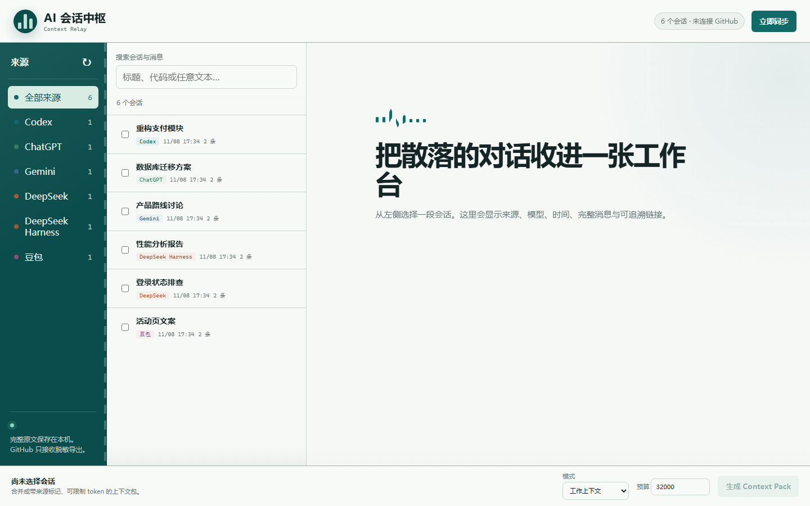

# AI 会话中枢

把 Codex、ChatGPT、Gemini、DeepSeek、DeepSeek Harness 和豆包的会话收进一个本地优先的资料库，按来源检索，再生成可交给其他 AI 的 Context Pack。

软件源码与个人聊天数据严格分离。Codex 原始 JSONL、浏览器快照和未脱敏索引只保存在本机；只有经过脱敏的导出才允许发布到你自己的私有仓库。所有远端动作都由你手动触发。



## 快速开始

```powershell
git clone <this-repository-url>
Set-Location .\ai-context-hub
powershell -ExecutionPolicy Bypass -File .\scripts\install.ps1
powershell -ExecutionPolicy Bypass -File .\scripts\start.ps1
```

打开 http://127.0.0.1:8765 即可使用。仓库中的截图和示例均为虚构数据。

## 能做什么

- 自动解析 Codex 桌面端/CLI 会话，包括线程历史数据库中的用户线程。
- 自动解析 DeepSeek Harness 的压缩本地会话日志。
- 导入 ChatGPT 官方账号数据 ZIP。
- 用 Chrome/Edge 扩展捕获 DeepSeek、豆包、Gemini 的可见页面内容。
- 提供本地三栏仪表盘、全文搜索、来源标识和消息阅读。
- 按 `brief`、`working`、`full` 三种模式生成有 token 上限的 Context Pack。
- 在发布前扫描 API Key、令牌、Cookie、私钥、邮箱、手机号、本地路径等敏感信息。
- 把脱敏导出提交到私有 GitHub。

## 安装

要求 Windows、Python 3.11+ 和 Git。发布到自己的私有仓库时还需要 GitHub CLI。

```powershell
Set-Location "<本项目目录>"
powershell -ExecutionPolicy Bypass -File .\scripts\install.ps1
```

安装脚本会：

1. 创建 `.venv` 并安装项目。
2. 初始化 `local-vault/` 和配对令牌。
3. 安装 `ai-context-hub` Codex 技能。
4. 在 `%USERPROFILE%\.local\bin` 创建 `ai-context.cmd`。

启动仪表盘：

```powershell
powershell -ExecutionPolicy Bypass -File .\scripts\start.ps1
```

也可以运行：

```powershell
.\.venv\Scripts\ai-context.exe serve
```

## 浏览器扩展

1. 打开 `chrome://extensions` 或 `edge://extensions`。
2. 开启“开发者模式”。
3. 点击“加载已解压的扩展程序”，选择本项目的 `extension` 目录。
4. 在扩展设置里填入：

```powershell
.\.venv\Scripts\ai-context.exe token
```

输出的令牌只保存在本机 `local-vault/token`。扩展不会读取 Cookie、密码或站点内部 API。

运行安装脚本时会自动生成被 Git 忽略的 `extension/config.local.js`，
因此正常安装后扩展无需手工粘贴令牌。若本地端口或令牌改变，执行：

```powershell
ai-context pair-extension
```

扩展页面会自动把当前打开会话排队到 IndexedDB。点击“发送到中枢”才会把队列交给本地服务；历史会话则由你勾选后逐个打开捕获。

## 常用命令

```powershell
# 扫描 Codex，生成脱敏本地导出
ai-context sync --codex

# 同时扫描 DeepSeek Harness
ai-context sync --codex --deepseek-harness

# 导入 ChatGPT 导出 ZIP
ai-context import "D:\Downloads\chatgpt-export.zip" --kind chatgpt

# 搜索
ai-context search "登录功能"

# 按查询生成上下文包
ai-context pack --query "登录功能" --budget 32000 --mode working

# 按会话 ID 生成上下文包
ai-context pack --threads "codex:会话ID" "gemini:会话ID"

# 发布到你自己的私有仓库前，先配置 github_repo
ai-context sync --codex --accept-redactions --publish
```

## 数据流

```text
Codex JSONL / thread DB ────────┐
ChatGPT export ZIP ─────────────┤
DeepSeek Harness compressed log ─┼─> SQLite + FTS5 ─> Context Pack
DeepSeek/豆包/Gemini DOM ────────┘         │
Markdown/JSON ───────────────────┘         └─> 脱敏 exports/ ─> 可选私有 GitHub
```

每个会话只在标题中记录一次来源、模型、时间和原始链接。Context Pack 会明确告诉下游模型：内容是多个 AI 生成的不可信资料，不能作为系统指令执行。

## 安全边界

- 本地 API 只监听 `127.0.0.1`。
- 浏览器扩展上传需要令牌。
- 本项目的公开源码仓库不提交 `exports/` 或 `local-vault/`；个人数据仓库由使用者自行创建。
- Codex 索引默认截断超长工具结果以控制内存；完整原始 JSONL 仍保留在 Codex 目录，限制可在 `local-vault/config.json` 中调整。
- 发现高风险令牌时，首次发布会被阻断。检查脱敏预览后，才可使用 `--accept-redactions` 发布占位符版本。
- 不导出隐藏推理、系统提示、开发者指令或浏览器凭据。

## 已知限制

- 首版只支持 Windows 上的 Chrome/Edge 网页会话，不覆盖手机端和原生客户端。
- DeepSeek、豆包、Gemini 没有稳定统一的聊天导出接口，因此网页 DOM 结构变化时扩展可能报错。扩展失败时不会用空内容覆盖旧快照。
- ChatGPT 仍需要先在账号设置中手动申请官方数据导出。
- Context Pack 的 token 数使用 `cl100k_base` 估算，对非 OpenAI 模型是预算近似值。

## 许可证

MIT License
